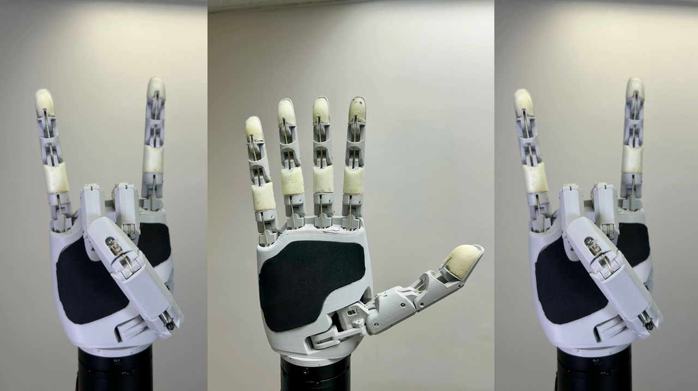
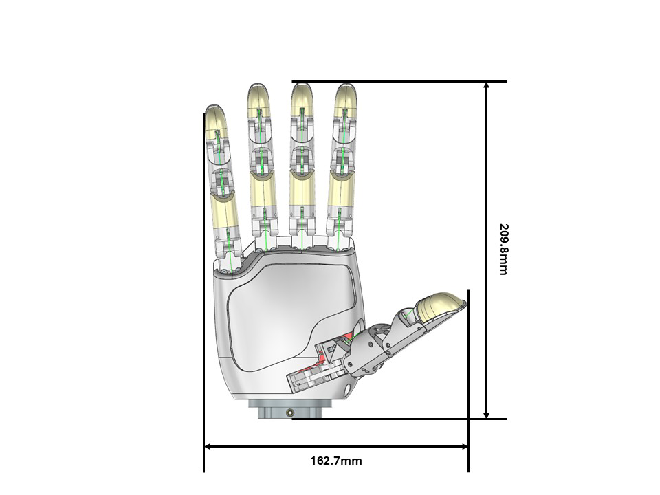
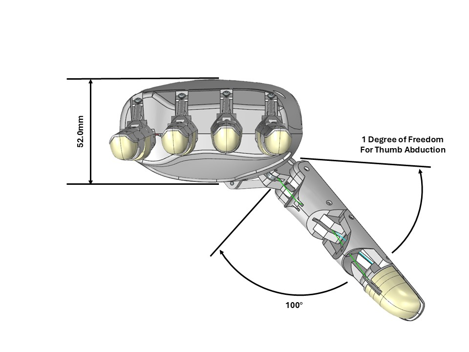
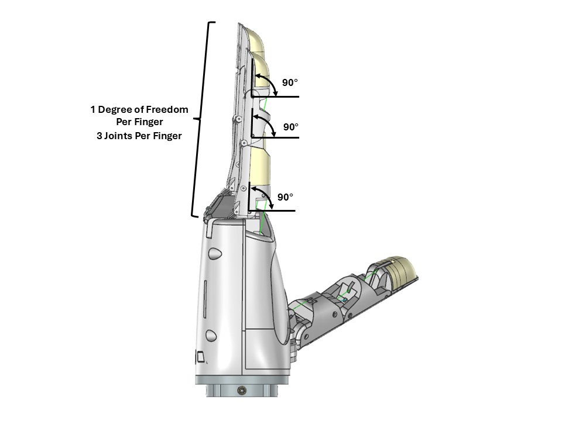
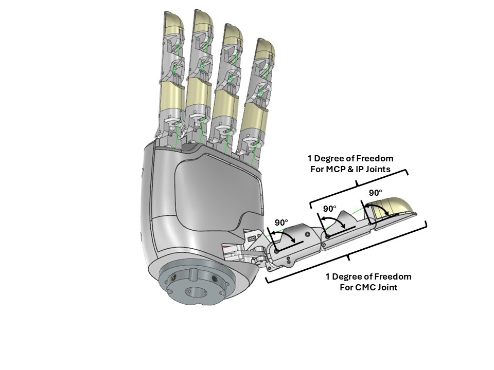
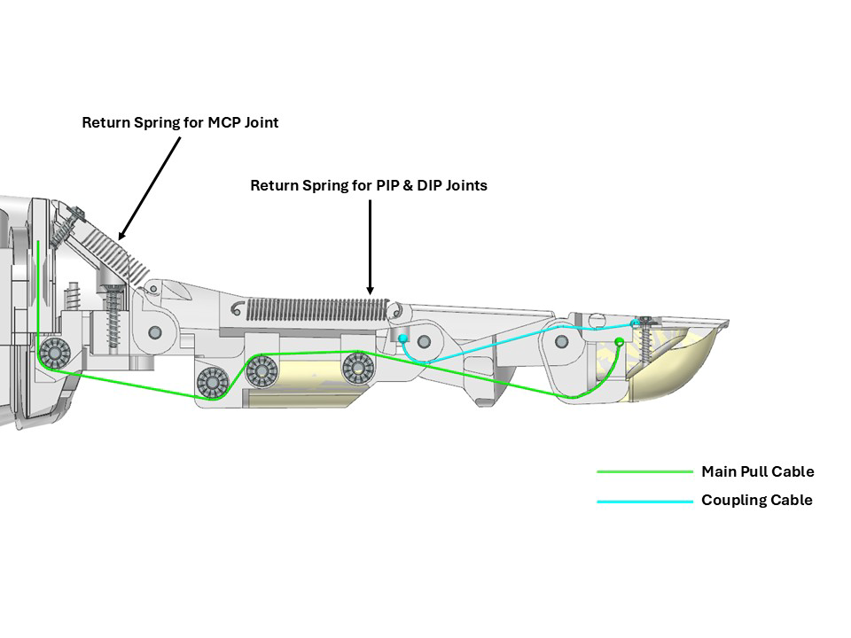
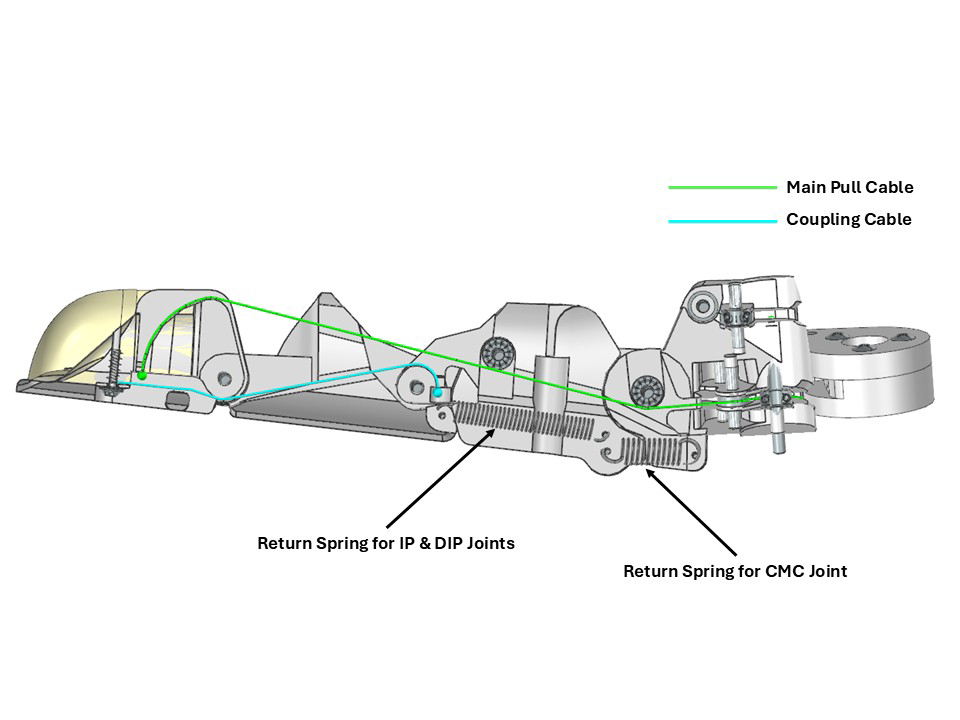
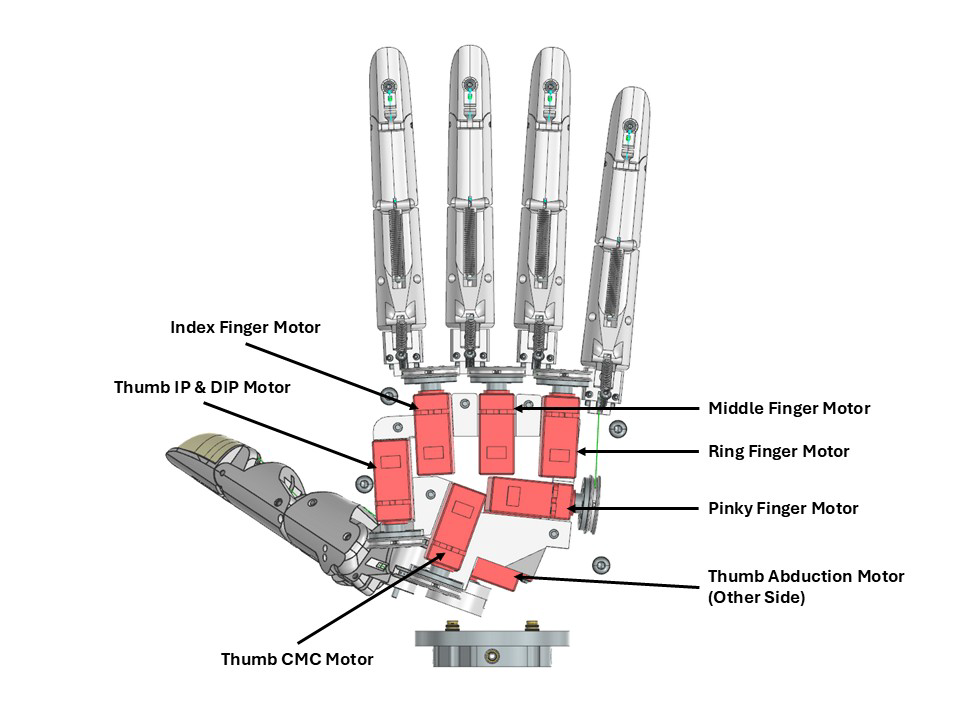

<p align="center">
  <a href="https://tetheria.github.io/aero-hand-open/"></a>
  <a href="https://docs.tetheria.ai/"></a>
  <a href="https://github.com/TetherIA/aero-hand-open/discussions"></a>
  <a href="http://discord.gg/ZQKWK7NebQ"></a>
  <a href="https://shop.tetheria.ai/"></a>
</p>

Aero Hand Open 是由 TetherIA 设计开发的一款**开源**、**腱绳驱动**的机器人灵巧手，面向灵巧操作研究。与昂贵商业方案不同，这款手强调**简洁**、**可靠**和**易获取**，全部采用标准 3D 打印和市售电子元件。

每个关节通过腱绳驱动实现机械效率优化，运动平滑自然，同时保持**轻量**、**紧凑**的设计。非常适合需要**经济实惠**但**功能完整**操作平台的研究实验室、教育机构和机器人爱好者。

> **了解更多：** https://tetheria.github.io/aero-hand-open/   
> **购买：** https://shop.tetheria.ai/

# 核心特性

- 5 指 7 自由度（共 16 个关节）
- 腱绳驱动架构，运动平滑自然
- 全 3D 打印结构，模块化、易组装
- 轻量化设计 — **仅 389 g**
- 高性价比 — 完整套件 **$314 USD**
- 开源硬件与固件
- 独立的 Python SDK，兼容 ESP32 和 ROS2 系统

# 目录
- [核心特性](#核心特性)
- [概览](#概览)
- [资源](#资源)
  - [物料清单 (BOM)](#物料清单-bom)
  - [CAD 与 3D 模型](#cad-与-3d-模型)
  - [装配指南](#装配指南)
  - [PCB 设计](#pcb-设计)
  - [硬件配置](#硬件配置)
  - [软件 SDK](#软件-sdk)
  - [ROS2 与遥操作](#ros2-与遥操作)
  - [仿真](#仿真)
  - [强化学习](#强化学习工具)
- [获取帮助](#获取帮助)
- [许可证 — TL;DR](#许可证--tldr)
- [免责声明](#免责声明)
- [社区与更新](#社区与更新)
  - [更新记录](#更新记录)
  - [FAQ](#faq)
  - [联系方式](#联系方式)

# 概览

  
  
  
  
  
  


# 资源
## 物料清单 (BOM)
构建 Aero Hand Open 所需组件的完整清单：

[👉 BOM.csv](./hardware/Assembly/BOM.csv)

文档列出了所有机械件、电子件和打印件——包括电机、腱绳、轴承、紧固件和 3D 打印部件。每项附有型号、供应商、数量和预估成本。

## CAD 与 3D 模型
STEP 文件和一键打印文件：

[👉 CAD 文件夹](./hardware/CAD/)  
[👉 Onshape 在线链接](https://cad.onshape.com/documents/afc7e0ca7eb6d412ec8771f8/w/bc4d7e45e17e23d622d2bad2/e/c711982b7882da925263fb55)

所有部件使用 Bambu X1C 打印：0.4mm 喷嘴、0.2mm 层高、树形支撑（仅打印床面）。建议保持相同的打印方向和设置。

## 装配指南
逐步装配说明：

[👉 装配指南](https://docs.tetheria.ai/docs/assembly)

涵盖从安装执行器到穿腱绳、连接电子元件的完整流程。每个手指模块可独立组装后安装到手掌上，便于维护和快速更换。

## PCB 设计
所有设计文件——Gerber、KiCad 工程、BOM、CPL——位于 [PCB 文件夹](./hardware/PCB/)。

技术细节参考 [PCB 文档](https://docs.tetheria.ai/docs/pcb)。

## 硬件配置

请参考 [硬件配置文档](https://docs.tetheria.ai/docs/hardware_setup)。

## 软件 SDK
请参考 [`sdk/README.md`](sdk/README.md) 和 [SDK 文档](https://docs.tetheria.ai/docs/sdk)。

### 序列演示
序列演示展示如何将不同手指动作组合成预设的连续序列。可执行复杂手势——如捏合、张开手掌、剪刀手——通过自动协调关节运动的时序完成。

示例代码位于 SDK 示例文件夹：  
👉 [`sdk/examples/`](sdk/examples)

安装 SDK 并配置串口后，直接运行：

```bash
python run_sequence.py
```

## ROS2 与遥操作
Aero Hand Open 无缝集成 ROS2 **Humble**。

参考 [ROS2 文档](https://docs.tetheria.ai/docs/ros2) 和 [`ros2/`](./ros2/) 文件夹获取完整配置说明和源码。

## 仿真

提供 Tetheria Aero Hand Open 的高保真仿真模型。目前支持 **MuJoCo**，更多平台正在开发中。

参考 [RL 与仿真文档](https://docs.tetheria.ai/docs/hand_sim) 和 [`sim_rl/simulation/`](./sim_rl/simulation/) 目录。

## 强化学习工具

基于 **mujoco_playground** 等最新框架提供强化学习工具，可轻松训练 Aero Hand Open 的自定义策略。

参考 [RL 与仿真文档](https://docs.tetheria.ai/docs/hand_sim) 和 [`sim_rl/mujoco_playground/`](./sim_rl/mujoco_playground/)。ROS 部署示例在 [`ros2/`](./ros2/) 中。

# 获取帮助

**GitHub Issues** — Bug + 功能请求。

**GitHub Discussions** — 装配/电子/机械问题、SDK/ROS2 使用问题、设计提案。

**Discord** — 快速答疑、实时调试、语音/屏幕共享、社区交流。

# 许可证 — TL;DR

[](#许可证--tldr)

- **允许**将从 TetherIA 购买的 Aero Hand 集成到您销售的商品机器人/产品中。
- **软件（固件 & SDK）：** Apache-2.0 — 允许商业使用。
- **设计文件（CAD/STEP/STL、图纸、BOM、文档）：** CC BY‑NC‑SA 4.0 — **仅限非商业**使用，衍生作品须同协议并注明出处。
- 想**商业制造/打印**或基于设计文件自行生产？→ **需获取商业制造许可**。
- **商业许可与批量采购：** 参见 [LICENSE.md](LICENSE.md)（或邮件 contact@tetheria.ai）。

© 2025 TetherIA Inc. 保留所有权利。

# 免责声明
Aero Hand Open 是一个面向教育和实验用途的开源研究原型。此设计未经验证适用于长时间或重载使用场景。

使用者在组装、操作或修改本设备时应谨慎。TetherIA Inc. 及其贡献者对因使用、误用或修改本设计导致的任何人身伤害、财产损失或其他损失不承担责任。

重要提示：
- 3D 打印件可能因打印机和材料设置存在公差变化。
- 腱绳驱动机构需定期调节张力以保持运动一致性。
- 过载或施加过大扭矩可能导致机械变形或舵机损坏。
- 本项目按现状提供，不附带任何担保。

# 社区与更新
## 更新记录
详见 [RELEASE_NOTES.md](RELEASE_NOTES.md) 或 [RELEASE_NOTES_CN.md](RELEASE_NOTES_CN.md)。

## FAQ
Q1: 我可以修改并二次分发 Aero Hand Open 设计吗？

A: 可以，但须遵守 CC BY-NC-SA 4.0 协议（非商业、署名、相同方式共享）。

Q2: 推荐哪些 3D 打印机和材料？

A: 床面 ≥200×200 mm 的 FDM 打印机。PLA 在强度和尺寸精度方面效果最佳。

更多问题请参考 [在线文档 FAQ](https://docs.tetheria.ai/docs/hardware_faq)。

## 联系方式
- 🛒 购买: [TetherIA Store](https://shop.tetheria.ai/)
- 📚 文档: [TetherIA Docs](https://docs.tetheria.ai/)
- 📧 邮箱: support@tetheria.ai
- 🌐 官网: [tetheria.ai](http://tetheria.ai)
- 🐙 GitHub: [TetherIA](https://github.com/TetherIA)
- 💬 Discord: [TetherIA Discord](http://discord.gg/ZQKWK7NebQ)
